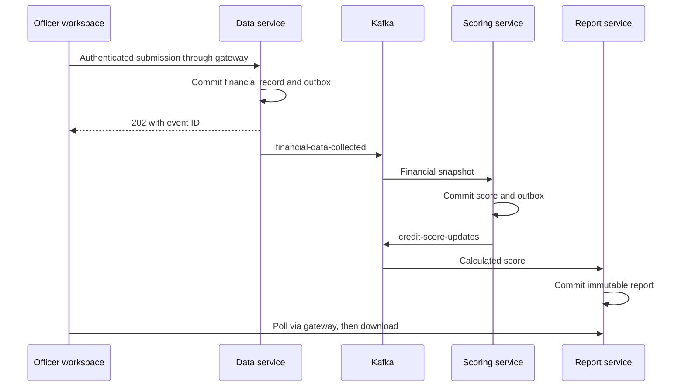

# Architecture and guarantees

## Service ownership

| Service | Database | Main tables | Port |
|---|---|---|---|
| User | credit_users | customers, audit_entries | 8081 |
| Data | credit_data | financial_records, outbox_entries, audit_entries | 8082 |
| Scoring | credit_scores | credit_scores, outbox_entries, audit_entries | 8083 |
| Report | credit_reports | credit_reports, audit_entries | 8084 |
| Keycloak | credit_identity | Keycloak-managed identity schema | 8180 externally |

The common migration also creates outbox tables in services that do not currently publish. Databases share one MySQL instance for economical local startup but have separate database users and grants. Services do not join one another's tables. Data-service verifies the customer's existence, active status, and currency through user-service using the original bearer token.

## Event flow

The Angular app polls every two seconds for up to 90 seconds after a submission. It matches the source event ID and the resulting report's score ID, so an older score is not mistaken for the just-submitted result. Changing the selected customer invalidates pending UI responses.

## Transactional outbox

The financial row, financial event outbox row, and audit row commit in one database transaction. Scoring similarly commits its score, outgoing event, and audit together. This prevents the ordinary dual-write failure where the database commits but the application loses the event before sending it.

A scheduled publisher locks up to 20 pending rows, publishes synchronously, and marks each row sent only after Kafka acknowledges it. Failed rows remain pending. The demo holds database locks while waiting for Kafka; this is deliberately simple and can limit throughput. A production relay or CDC pipeline can replace it.

There is still a crash window after Kafka accepts a message but before the database marks it published. Therefore delivery is **at least once**, not exactly once. Scoring deduplicates by `sourceEventId`; reporting deduplicates by event ID and has a unique score ID. Database constraints enforce the final boundary. A concurrent duplicate can trigger a transaction rollback and retry, after which the existing row is recognized.

Financial submissions accept a UUID `Idempotency-Key`. Repeating an identical payload for the same customer and officer returns the original event and source version. Reusing the key for another payload, officer, or customer returns 409. Simultaneous requests can race on the unique constraint; a client can retry the same original key. The frontend retains its key when a request fails and issues a new one when the payload changes or the previous analysis completes.

Outbox and audit rows are retained indefinitely in this demo. Production retention and pruning require a deliberate policy.

## Ordering, schema, and failures

- Both business topics use three partitions, with customer ID as the message key. Their dead-letter topics have matching partitions.
- Each financial record receives a database-generated monotonically increasing `sourceVersion`. This is global within data-service, not a per-customer sequence or a timestamp.
- The latest score is selected by highest source version. A late older event creates a historical snapshot without replacing a newer latest score.
- Events carry `schemaVersion=1`, UUID identifiers, and timestamps. Scoring validates the financial payload again at the consumer boundary.
- Consumers retry failed records three times at one-second intervals, then publish to `<original-topic>.DLT`. If dead-letter publication fails, the record is not silently treated as recovered.
- Dead letters require investigation and deliberate replay after correcting the cause. There is no automatic replay admin UI in this version.
- Kafka's local single-broker setup uses replication factor one. It is not highly available. Increasing partitions later can alter key-to-partition mapping, so ordering assumptions must be revisited.

## Cache and snapshots

Redis keys are `credit:score:v1:<score UUID>` with a ten-minute TTL. The database remains authoritative for selecting the latest score; only immutable score views are cached. This avoids a stale mutable `latest` key overwriting a newer score after out-of-order consumption. Redis failures fall back to database-backed views. The UI's history and latest views are read-only; cache expiry never deletes database data.

Each report stores the exact calculated result and source version. Its PDF is rendered from that snapshot rather than recalculating using whatever algorithm exists later.

## Identity and access

Keycloak handles passwords and sign-in. Angular is a public OIDC client using authorization code flow with PKCE S256. Tokens are held in memory by the Keycloak adapter; the HTTP interceptor refreshes the token and attaches it only to relative `/api/` requests.

Both gateway and business services validate JWT signatures through JWKS, expiration, issuer, and the `credit-api` audience. OFFICER and ADMIN may use the business APIs; ADMIN is required for audit endpoints. Customers are business records and do not have login accounts. All authorized officers can access all demo customers: there is no per-officer assignment or tenant boundary.

CSRF protection is disabled for the stateless bearer-token APIs. No cookie-based API session is used. Browser requests use the same origin through Nginx or the Angular development proxy. Health endpoints are public; other actuator endpoints are not opened by the security rules.

## Logs and audit

Each HTTP request receives a validated or generated `X-Request-ID`, returned in the response and added to the service log context. Logs contain request method, path, status, and duration, without request bodies or bearer tokens. Log4j2 emits ECS JSON that can be shipped to a log system. Splunk itself is not included.

Audit rows record actor, action, resource, and timestamp in the owning service. Read access is administrator-only. This is an application audit trail, not a tamper-proof compliance ledger. SMTP delivery and writing its audit entry are not atomic; email retry can duplicate a message.

## Educational algorithm

Scores range from 300 through 850. All monetary calculations use BigDecimal; rounding is HALF_UP. Input validation rejects zero/negative income, negative debt, utilization outside 0–100, fractional counts, invalid currencies, and values beyond the declared limits.

| Factor | Formula | Maximum |
|---|---|---|
| Base | Fixed 300 | 300 |
| Payment history | max(0, 200 − 40 × missed payments) | 200 |
| Credit utilization | round((100 − utilization percent) × 1.5) | 150 |
| Debt affordability | round((1 − min(debt / income, 1)) × 100) | 100 |
| History length | round(min(months, 120) × 0.625) | 75 |
| Recent inquiries | max(0, 25 − 5 × inquiries) | 25 |

Demo risk bands are LOW at 750+, MODERATE at 650–749, and HIGH below 650. Sample inputs 80000 income, 12000 debt, 25% utilization, no missed payments, 72 months of history, and one inquiry produce **300 + 200 + 113 + 85 + 45 + 20 = 763**.

The brief did not provide a usable proprietary scoring algorithm. This transparent `educational-v1` model makes the project runnable and explainable. Its weights and labels are not validated predictions, financial advice, or a basis for credit decisions.

## Before any production adaptation

Replace demo credentials and service accounts, use TLS and authenticated Kafka, isolate infrastructure, establish authorization/tenant rules, validate the real model, address privacy and retention, add metrics/tracing/alerts, test MySQL concurrency and recovery, and design broker/database availability. These are future engineering tasks, not capabilities claimed by this local project.
